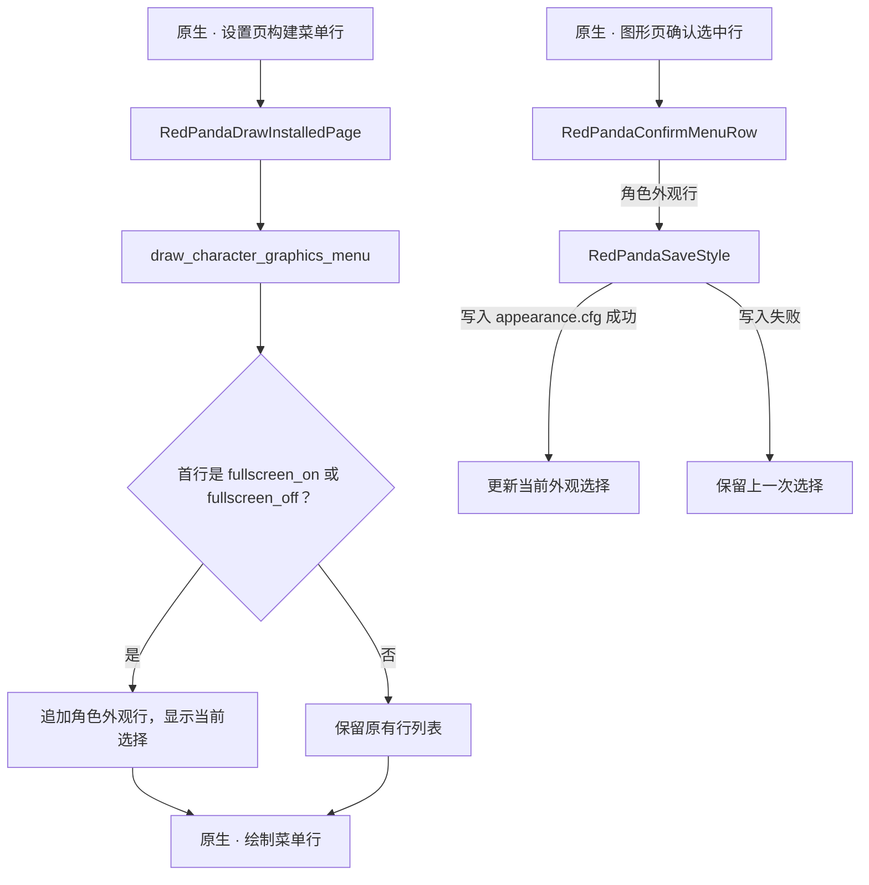
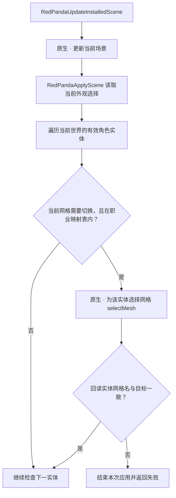

# 沉星之序 · 小熊猫外观

在游戏的「设置 → 图形 → 角色外观」中，可以在原版和小熊猫之间切换。十个职业共用一个外观选项，已有独立模型的职业变体保留各自的资源名。

## 安装与卸载

打开安装包里的 `Panda.exe`，确认自动识别的游戏目录，关闭游戏后点「安装插件」。完成后可点「打开游戏」。卸载时关闭游戏，在同一面板点「卸载插件」。安装器依据所选目录的安装记录恢复文件。

## 技术路径

安装阶段准备原版和小熊猫两套资源，并为支持的 Steam 构建接入菜单绘制、菜单确认、场景更新和职业分类。游玩时切换的是角色当前绑定的网格。以下图中标为「原生」的函数使用按逆向结果命名的职责描述，英文插件函数名与仓库源码一致。

### 图形菜单如何控制外观

声音页和图形页都可以有六行，也共用行绘制函数。插件读取翻译前的首行键识别图形页，因此全屏开关和界面语言都不会改变判断。首次读取选择时，`RedPandaReadStyle` 从插件目录加载配置，缺省为原版。[菜单入口](runtime/graphics_menu.cpp) · [页面判定](runtime/graphics_menu_row.hpp) · [配置读写](runtime/style_assets.cpp)

### 场景中的角色如何换回原版或换成小熊猫

以战士为例，原版网格名为 `warrior`，小熊猫为 `red_panda_warrior`。切回时反向查同一映射。场景更新会再次遍历角色，因此新出现的实体也能应用当前选择，已经匹配的实体会跳过重绑。[实体筛选、职业映射与网格回读](runtime/scene_style.cpp)

### 游戏如何识别换装后的职业

逆向时发现，网格绑定和职业分类都读取实体的模型名称。早期交叉测试中，传送法师换成商人外形后仍可与水晶换位，头顶编号却从 3 变成了 9。因此插件在职业查询入口把外观别名还原为原职业名，实体本身继续持有选中的外观网格。[职业分类适配](runtime/scene_style.cpp) · [逆向观察与早期实验记录](runtime/接口核查.md)
