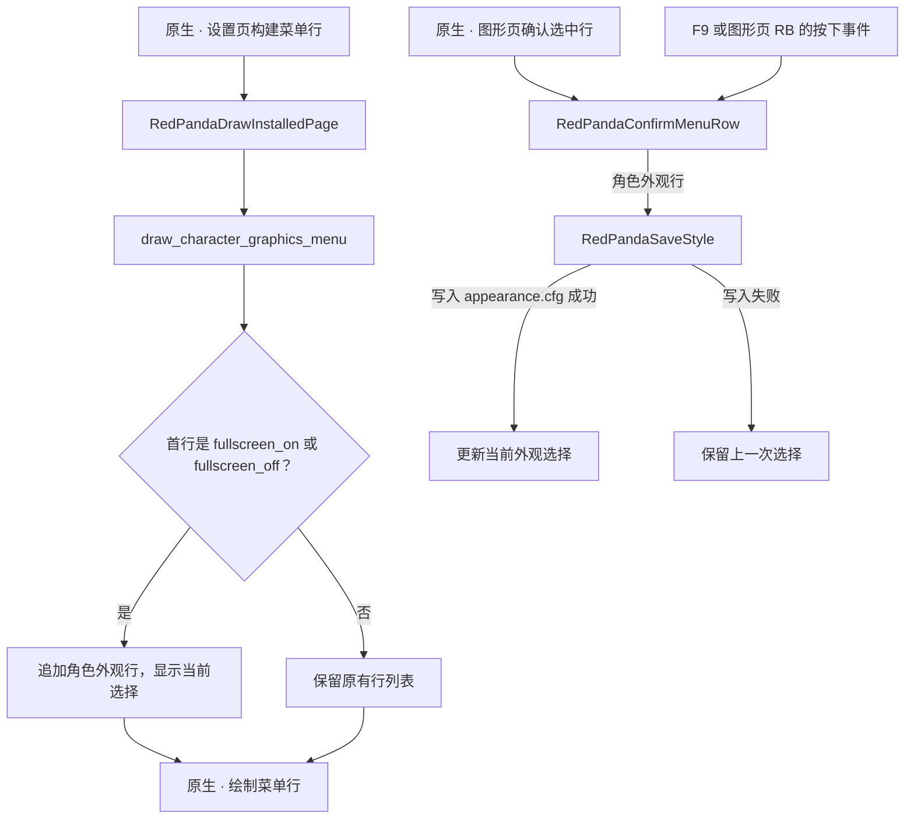
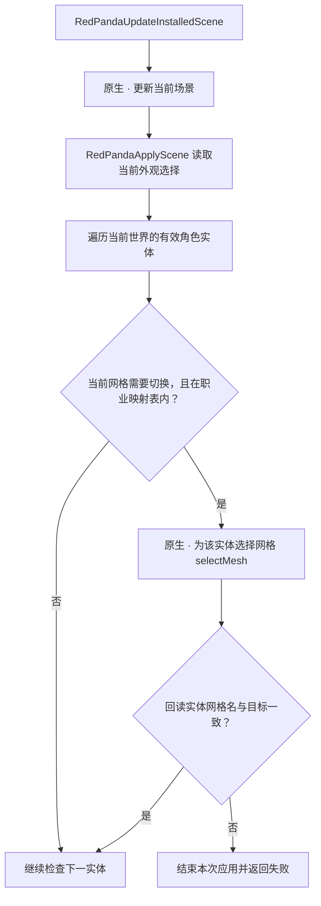

# 沉星之序 · 小熊猫外观

在游戏的「设置 → 图形 → 角色外观」中，可以在原版和小熊猫之间切换。十个职业共用一个外观选项，已有独立模型的职业变体保留各自的资源名。

本版对应 Windows x64 Steam 版（App ID 499170，游戏标题画面显示 revision 68307）。运行时适配与原版可执行文件的版本绑定。

## 安装与卸载

打开安装包里的 `Panda.exe`，确认自动识别的游戏目录，关闭游戏后点「安装插件」。完成后可点「打开游戏」。卸载时关闭游戏，在同一面板点「卸载插件」。安装器依据所选目录的安装记录恢复文件。

安装器通过 Steam 库和游戏清单寻找目录。若未找到，点「浏览」选择包含 `sinking_star.exe` 的文件夹。界面优先读取游戏日志中的语言，其次读取 Steam 为该游戏设置的语言。安装后面板显示「已安装」，并启用卸载按钮。更新已有菜单版时，先卸载旧版，再用新版安装。安装记录和备份位于游戏目录的 `.panda-install`，卸载前请保留它。

### 快捷切换

键鼠在关卡或图形设置页按 **F9**；标准 XInput 手柄在**图形设置页**按 **RB / R1**，无需先选中外观行。两者都调用菜单的确认函数，并保存同一份外观偏好。游戏默认键位表在关卡内用 RB 奔跑，在菜单内留空，因此手柄快捷键限定在图形页。带独立背键的手柄也可通过 Steam Input 把空闲背键映射为 F9，在关卡内切换。

### 单文件安装器

Windows x64 单文件版包含 WPF 运行时和全部插件资源。首次运行时由 .NET 将内嵌文件展开到当前用户的缓存目录。发布时给 `dotnet publish installer/Panda.csproj -c Release` 传入 `-p:PandaPayload=<包含 plugin.json 的绝对目录>`。发布的 EXE 支持 `--verify-payload` 校验内嵌清单和资源，以及 `--self-test` 测试安装和卸载。

## 资源如何进入游戏

安装器校验清单后，把菜单适配、插件、双套模型和配套资源写入所选游戏目录。角色网格以职业名和带 `red_panda_` 前缀的别名并存。构建安装包时同步准备材质、动画、关卡资源目录、描边配置和菜单翻译，使游戏能按目标名称解析外观。一次菜单切换只需保存选择、更新实体的网格绑定；资源包在安装时已经就位。

| 职业 | 原版网格名 | 单独适配的变体 |
|---|---|---|
| 战士 | `warrior` | `warrior_alt` |
| 盗贼 | `thief` | `thief_alt` |
| 传送法师 | `wizard` | — |
| 女祭司 | `cleric` | `cleric_alt` |
| 吟游诗人 | `bard` | — |
| 德鲁伊 | `druid` | — |
| 水手 | `castaway` | `castaway_alt` |
| 月人 | `moonman` | `moonman_alt` |
| 商人 | `trader` | `trader_alt` |
| 女王 | `queen` | — |

## 技术路径

安装阶段准备原版和小熊猫两套资源，并为支持的 Steam 构建接入菜单绘制、菜单确认、场景更新和职业分类。游玩时切换的是角色当前绑定的网格。以下图中标为「原生」的函数使用按逆向结果命名的职责描述，英文插件函数名与仓库源码一致。

### 图形菜单如何控制外观

声音页和图形页都可以有六行，也共用行绘制函数。插件读取翻译前的首行键识别图形页，因此全屏开关和界面语言都不会改变判断。首次读取选择时，`RedPandaReadStyle` 从插件目录加载配置，缺省为原版。

### 场景中的角色如何换回原版或换成小熊猫

以战士为例，原版网格名为 `warrior`，小熊猫为 `red_panda_warrior`。切回时反向查同一映射。场景更新会再次遍历角色，因此新出现的实体也能应用当前选择，已经匹配的实体会跳过重绑。

### 游戏如何识别换装后的职业

逆向时发现，网格绑定和职业分类都读取实体的模型名称。早期交叉测试中，传送法师换成商人外形后仍可与水晶换位，头顶编号却从 3 变成了 9。因此插件在职业查询入口把外观别名还原为原职业名，实体本身继续持有选中的外观网格。

## 从源码构建与验证

在 Windows x64 上构建。运行时工程使用 Visual C++ v141 和 Windows SDK 10.0.17763.0，面板使用支持 .NET 8 的 SDK。重新生成完整资源包还需要匹配版本的原版游戏文件、整理好的小熊猫资源目录（含 `assets.json`）、ssloader 的 `winmm.dll`，以及 Python 3.11 和打包脚本依赖。下例中的尖括号代表这些输入的实际路径。

1. 在 Visual Studio 开发者命令行编译运行时：`msbuild runtime/RedPanda.vcxproj /p:Configuration=Release /p:Platform=x64`。
2. 从仓库根目录运行 `py packaging/build_payload.py "<小熊猫资源目录>" "<原版游戏目录>/data/strings" "<loader目录>/winmm.dll" "<编译输出>/RedPanda.dll" "<新建payload目录>"`。输出目录须尚未存在。若发行包还要支持从旧的直接替换版迁移，额外传入 `--stock "<原版备份根目录>" --rules "<迁移规则.json>"`。
3. 运行 `dotnet publish installer/Panda.csproj -c Release "-p:PandaPayload=<payload绝对路径>" -o dist`。已有完整 payload 时可直接从这一步发布。将生成的 `Panda.exe` 单独放进空目录，即可检验单文件交付。
4. 在 PowerShell 中分别运行 `(Start-Process .\Panda.exe --verify-payload -Wait -PassThru).ExitCode` 和 `(Start-Process .\Panda.exe --self-test -Wait -PassThru).ExitCode`。两项成功时均返回 0。

### 当前验证范围

单文件发行版已在仅含 EXE 的目录中通过内嵌资源校验和安装卸载自检。菜单绘制函数也经过单独测试：声音页保留六行，窗口和全屏两种图形页均绘制七行。F9 和 RB 已核对默认键位并编译进插件；本版尚待在实际关卡按 F9、用实体手柄在图形页按 RB，确认画面切换及松开再按时的行为。完整实机验收还应检查切回原版、重启后保留选择，以及切换前后职业编号和携带物件的一致性。
