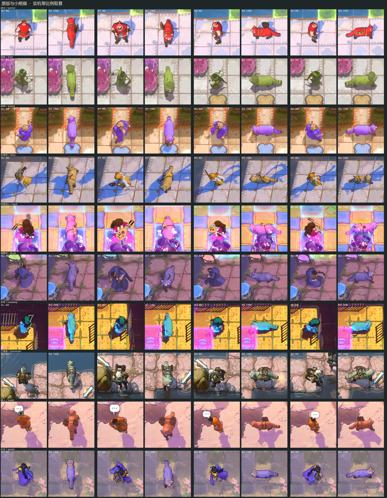
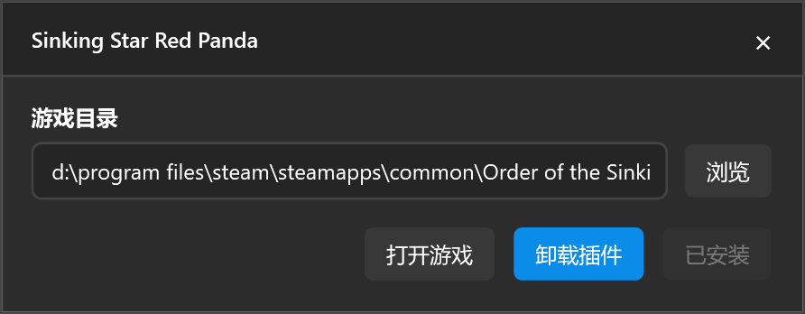
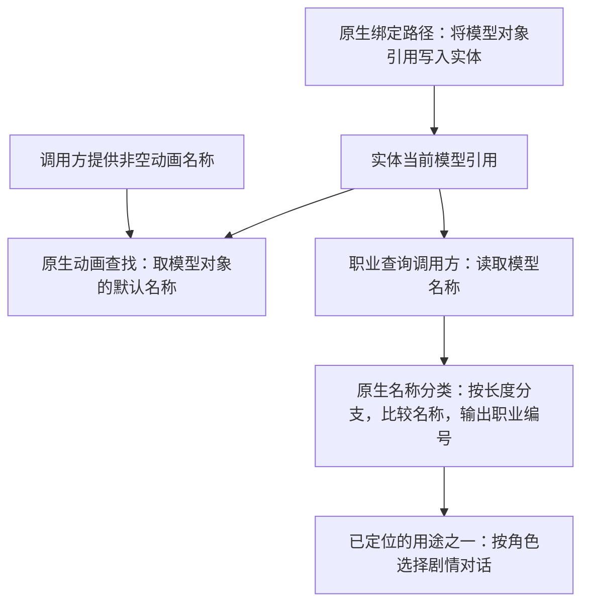
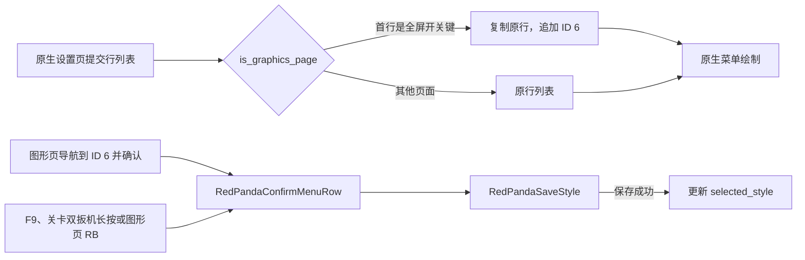
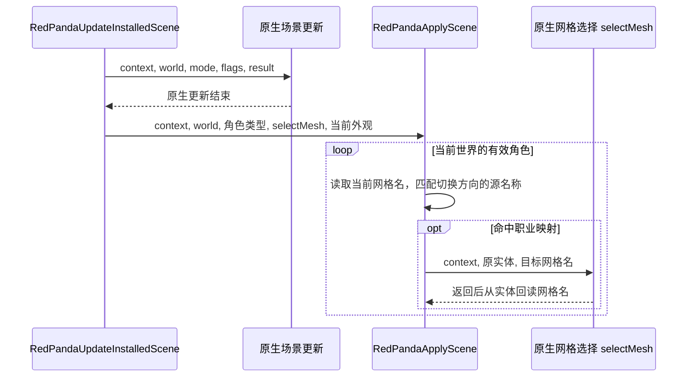

# 《沉星之序》小熊猫外观

在游戏的「设置 → 图形 → 角色外观」中，可以在原版和小熊猫之间切换。十个职业共用一个外观选项，已有独立模型的职业变体保留各自的资源名。

本版对应 Windows x64 Steam 版（App ID 499170，游戏标题画面显示 revision 68307）。运行时适配与原版可执行文件的版本绑定。

## 实机展示

[查看十职业实机总图原图](https://github.com/dreamstring/SinkingStarRedPanda/releases/download/v1.0.0/heroes-gameplay.png)

**实机演示：切换角色外观**

在游戏中切换原版角色与小熊猫外观，查看切换前后的角色造型。

https://github.com/user-attachments/assets/afd0903d-b3e7-48ff-999f-b29374654dc8

**动作对比：原版月人与小熊猫月人**

对照两种外观下的同一段操作：月人用腕杖连续两次推动魔镜。

https://github.com/user-attachments/assets/7eb6a0eb-ac0f-4198-b7c3-bbd9ce4a2400

## 安装与卸载

打开安装包里的 `Panda.exe`，确认自动识别的游戏目录，关闭游戏后点「安装插件」。完成后可点「打开游戏」。卸载时关闭游戏，在同一面板点「卸载插件」。安装器依据所选目录的安装记录恢复文件。

安装器通过 Steam 库和游戏清单寻找目录。若未找到，点「浏览」选择包含 `sinking_star.exe` 的文件夹。界面优先读取游戏日志中的语言，其次读取 Steam 为该游戏设置的语言。安装后面板显示「已安装」，并启用卸载按钮。从 v1.0.2 起，打开新版安装器并选中旧版所在目录，「更新插件」和「卸载插件」会同时可用。关闭游戏后直接点「更新插件」即可。标题显示内置版本，游戏目录旁显示已安装版本。安装记录和备份位于游戏目录的 `.panda-install`，卸载前请保留它。

### 快捷切换

键鼠按 **F9**。XInput 手柄在关卡内同时按到底 **LT + RT（L2 + R2）并保持 0.8 秒**；松开两个扳机后才能再次触发。在图形设置页也可以点按 **RB / R1**。组合键由插件读取，原生手柄布局图不会显示它。两个扳机各自的加速和减速绑定仍然生效，建议站定时切换。

### 单文件安装器

Windows x64 单文件版包含 WPF 运行时和全部插件资源。首次运行时由 .NET 将内嵌文件展开到当前用户的缓存目录。发布时给 `dotnet publish installer/Panda.csproj -c Release` 传入 `-p:PandaPayload=<包含 plugin.json 的绝对目录>`。发布的 EXE 支持 `--verify-payload` 校验内嵌清单和资源，以及 `--self-test` 测试安装和卸载。

## 资源如何进入游戏

安装器校验清单后，把菜单适配、插件、双套模型和配套资源写入所选游戏目录。角色网格以职业名和带 `red_panda_` 前缀的别名并存。构建安装包时同步准备材质、动画、关卡资源目录、描边配置和菜单翻译，使游戏能按目标名称解析外观。一次菜单切换只需保存选择、更新实体的网格绑定；资源包在安装时已经就位。

每个职业占一行。切换外观时，默认模型在「原版」和「Mod」之间切换，变体模型在「变体」和「变体 Mod」之间切换。「—」表示该职业没有单独的变体映射。

| 职业 | 原版 | Mod | 变体 | 变体 Mod |
|---|---|---|---|---|
| 战士 | `warrior` | `red_panda_warrior` | `warrior_alt` | `red_panda_warrior_alt` |
| 盗贼 | `thief` | `red_panda_thief` | `thief_alt` | `red_panda_thief_alt` |
| 传送法师 | `wizard` | `red_panda_wizard` | — | — |
| 女祭司 | `cleric` | `red_panda_cleric` | `cleric_alt` | `red_panda_cleric_alt` |
| 吟游诗人 | `bard` | `red_panda_bard` | — | — |
| 德鲁伊 | `druid` | `red_panda_druid` | — | — |
| 水手 | `castaway` | `red_panda_castaway` | `castaway_alt` | `red_panda_castaway_alt` |
| 月人 | `moonman` | `red_panda_moonman` | `moonman_alt` | `red_panda_moonman_alt` |
| 商人 | `trader` | `red_panda_trader` | `trader_alt` | `red_panda_trader_alt` |
| 女王 | `queen` | `red_panda_queen` | — | — |

## 逆向与替换实现

### 接入位置

游戏通过模型名找显示资源，也用同一个名字判定职业。曾把传送法师的模型换成商人做对照：法师还能和水晶换位，头顶编号却从 3 变成了 9。另一路动画查找虽然接受显式名称，但从这个入口只能确认动画选择，无法确认绘制网格也随之更新。最终实现选择在原实体上调用游戏自己的网格选择函数，并在职业查询时还原名称。

#### 在原生引擎里追到的读写关系

逆向的关键对象是**实体当前绑定的模型引用**。把原生函数的反编译结果放在一起看，可以对上一次写入和两类读取。下图的函数名是按行为起的描述名；三条路径通过实体数据关联，执行时可以发生在不同阶段。

| 追踪位置 | 反编译中能观察到什么 | 对替换方案的影响 |
|---|---|---|
| 实体绑定与动画查找 | 绑定路径把对象引用写入实体。动画查找先按实体类型选动画存储位置，再从绑定对象取默认名称；调用者传入非空名称时，查找采用传入值。 | 改动画查询参数能改变查找目标。这段函数没有证明渲染网格也会随之改变，因此它不足以单独承担整套外观切换。 |
| 名称与职业 | 另一条路径从实体读取同一处引用，把名称交给分类函数。分类函数按长度及字符串内容匹配；找到的 11 个直接调用点中，有一处位于带水手、测量员对话键的剧情分支。 | 若把外观名作为职业名一路传下去，影响可以越过绘制层。运行时在这些查询入口转换参数，让实体继续持有小熊猫模型。 |
| 场景更新与网格选择 | 原生场景更新接收上下文和世界。插件保留原调用，返回后对当前世界中的角色调用游戏已有的网格选择函数，再从该实体回读绑定名称。 | 可以在同一实体上验证名称是否换成目标，下一次更新也能据此跳过已完成的角色。回读验证覆盖到实体绑定这一层。 |

**证据边界。** 法师换商人后头顶编号变化，是实机观察；职业查询会读取模型名称，是静态调用链证据。两者支持在分类入口还原职业名，但还没有逐条追出头顶数字从分类结果到界面绘制的完整链路。同样，当前实现确认到原生网格选择与实体回读，尚未追清该函数内部怎样让渲染缓存失效、何时提交新的绘制资源。文中的“热切换”指在运行中的场景更新里完成重绑。

发布版在构建时为匹配的 Steam 程序接入四个插件入口。下表按调用职责描述逆向识别的原生函数；插件入口名与源码一致。

| 原生调用位置 | 插件入口 | 如何继续原生调用 |
|---|---|---|
| 设置页提交菜单行 | `RedPandaDrawInstalledPage` | 将行列表交回原生绘制函数，沿用原布局、选中项和颜色 |
| 图形页确认新增行 | `RedPandaConfirmMenuRow` | 处理外观行后返回原确认流程 |
| 场景更新 | `RedPandaUpdateInstalledScene` | 先执行原生更新，再使用同一上下文和世界遍历角色 |
| 按模型名查询职业的 11 个直接调用点 | `RedPandaClassifyInstalledProfession` | 转换查询名称后调用原生分类函数，由它填写职业编号 |

### 菜单：绘制、导航、确认

图形页和声音页共用绘制函数，且都能提交六行。判定函数检查首行本地化键 `fullscreen_on` 或 `fullscreen_off`。匹配后在临时列表中追加当前外观的文案；图形页的导航范围也从六项扩为七项，使新增行可以获得焦点。确认时按行 ID 分派。快捷键复用同一确认函数，持续按住只切一次。

### 场景：保留实体，按目标网格重绑

例如场上是 `warrior_alt`，选择小熊猫时只匹配这对映射的原版端，目标为 `red_panda_warrior_alt`；切回时交换两端。函数先确认上下文指向当前世界，再筛选有效槽位和角色类型。已处于目标外观的实体不会再次命中源名称。新出现的实体由后续更新覆盖。回读失败会提前返回 `-1`，已完成的重绑保留；当前调用方没有单独显示这个错误。

### 职业：只转换查询参数

`RedPandaProfessionName` 返回映射表中的原名称，未知名称原样透传。适配器将返回值作为参数传给原生分类函数，实体仍持有小熊猫网格。这条路径兼顾了上面法师实验暴露的两个需求：渲染能持续使用外观别名，依赖职业名的调用方仍能取得原职业编号。

## 从源码构建与验证

在 Windows x64 上构建。运行时工程使用 Visual C++ v141 和 Windows SDK 10.0.17763.0，面板使用支持 .NET 8 的 SDK。重新生成完整资源包还需要匹配版本的原版游戏文件、整理好的小熊猫资源目录（含 `assets.json`）、ssloader 的 `winmm.dll`，以及 Python 3.11 和打包脚本依赖。下例中的尖括号代表这些输入的实际路径。

1. 在 Visual Studio 开发者命令行编译运行时：`msbuild runtime/RedPanda.vcxproj /p:Configuration=Release /p:Platform=x64`。
2. 从仓库根目录运行 `py packaging/build_payload.py "<小熊猫资源目录>" "<原版游戏目录>/data/strings" "<loader目录>/winmm.dll" "<编译输出>/RedPanda.dll" "<新建payload目录>"`。输出目录须尚未存在。若发行包还要支持从旧的直接替换版迁移，额外传入 `--stock "<原版备份根目录>" --rules "<迁移规则.json>"`。
3. 运行 `dotnet publish installer/Panda.csproj -c Release "-p:PandaPayload=<payload绝对路径>" -o dist`。已有完整 payload 时可直接从这一步发布。将生成的 `Panda.exe` 单独放进空目录，即可检验单文件交付。
4. 在 PowerShell 中分别运行 `(Start-Process .\Panda.exe --verify-payload -Wait -PassThru).ExitCode` 和 `(Start-Process .\Panda.exe --self-test -Wait -PassThru).ExitCode`。两项成功时均返回 0。

### 当前验证范围

单文件发行版已在仅含 EXE 的目录中通过内嵌资源校验和安装卸载自检。菜单绘制函数也经过单独测试：声音页保留六行，窗口和全屏两种图形页均绘制七行。F9 和 RB 已核对默认键位并编译进插件；本版尚待在实际关卡按 F9、用实体手柄在图形页按 RB，确认画面切换及松开再按时的行为。完整实机验收还应检查切回原版、重启后保留选择，以及切换前后职业编号和携带物件的一致性。
